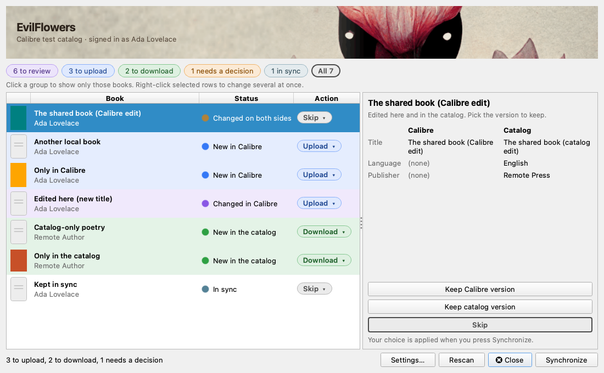

# EvilFlowers for Calibre

A Calibre plugin that keeps a Calibre library in sync with a catalog on an
[EvilFlowers](https://github.com/EvilFlowersCatalog/EvilFlowersCatalog) server. Point
several computers at the same catalog and they share one library: books, metadata,
covers and EPUB/PDF/MOBI files.

- Books new in Calibre are uploaded. Entries new in the catalog are downloaded.
- A change on one side is applied to the other. When both sides changed, you choose.
- **Nothing is ever deleted**, on either side.
- Browse and search the catalog, keep your EvilFlowers shelf, and read back the
  passages you highlighted in the EvilFlowers reader.

Requires Calibre 7 or newer (tested on Calibre 9.15). Light and dark themes are both
supported. What changed in each version is in the [changelog](CHANGELOG.md).



More screens, in light and dark, are in [docs/](docs/README.md).

## Use

1. Install `dist/evilflowers-<version>.zip` (Preferences → Plugins → *Load plugin from
   file*) and add the **EvilFlowers** button to a toolbar.
2. In the button's menu, choose **Settings…**. Enter your site's address (for example
   `https://elvira.stuba.sk`), press **Sign in…** and log in with your EvilFlowers
   username and password. Then pick a catalog from the list.
3. Click the button. The plugin compares the library with the catalog and lists
   every book with what it will do: *upload*, *download* or *skip*. Change any row
   (right-click for several at once), then press **Synchronize**.

### Signing in

The plugin uses your password once, to create an API key named *Calibre on
&lt;computer&gt;*, and stores only that key, never the password. You can see and revoke
the key in your EvilFlowers profile. **Sign out** revokes it for you, and **Switch
account** replaces it.

Prefer a key you made yourself? Choose *Use an API key instead* and paste it. A pasted
key is only forgotten on sign-out, never revoked.

### The sync window

The chips above the list show how many books are in each group: *to review*, *to
upload*, *to download*, *need a decision*, *in sync*, *all*. Click one to show only
those books.

| Status | Meaning | Default |
| --- | --- | --- |
| new in Calibre / new in catalog | exists on one side only | upload / download |
| changed in Calibre / changed in catalog | one side changed since the last sync | upload / download |
| changed on both sides | conflict | skip: pick a side |
| same book on both sides, never synced | same UUID, no sync record | skip: pick a side |
| deleted in Calibre / deleted in catalog | gone on one side after a sync | skip (download or upload restores it) |

Select a book that *needs a decision* and a panel compares the two versions field by
field. Pick *Keep Calibre version*, *Keep catalog version* or *Skip*.

What travels: title, authors, language, tags (as categories), comments (as summary),
publisher, publication date, identifiers (ISBN, DOI, Google, Dataverse), cover, and
EPUB/PDF/MOBI files. Everything else (series, rating, custom columns, other formats)
stays local and is never overwritten by a download.

### What's in the menu

- **Synchronize…** opens the sync window (same as clicking the button).
- **Browse catalog…** searches the catalog, filters by language and category, and
  downloads just the books you pick. *In your library* and *On your shelf* badges show
  what you already have. Add or remove books from your EvilFlowers shelf here.
- **Highlights for selected book…** shows what you highlighted while reading the
  selected books in EvilFlowers, grouped and with page numbers. **Copy** puts them on
  the clipboard; **Save to &lt;column&gt;** writes them into a custom column (see
  below). Highlights are read-only: nothing is sent back.
- **Settings…** and **About EvilFlowers**.

### Settings

Each field also explains itself on the settings page.

| Setting | What it does |
| --- | --- |
| Server | The address of your EvilFlowers site. |
| Catalog | Which catalog on that server this library syncs with. |
| Direction | *Both ways* keeps library and catalog the same. *Upload only* never changes your library (the browser's Download is off too). *Download only* never changes the catalog. |
| Uploaded files are | *Acquisition*: only signed-in readers can download them. *Open access*: anyone who can see the catalog can. |
| Default language | Used for books without a language; the catalog requires one. |
| Only download books on my shelf | New catalog entries are offered only when they are on your EvilFlowers shelf. Books already linked keep syncing. |
| Copy highlights into | A long-text custom column the Highlights window can save into. Syncing does not refresh it. |

### Upgrading

- **From 2.0:** nothing to do. Your API key keeps working, and **Sign in…** replaces
  it with one the plugin can revoke on sign-out.
- **From 0.x:** remove the old *EvilFlowers OPDS client* plugin first. Its settings
  (server, API key, catalog) are carried over.

## How it works

```
calibre_plugin/
  __init__.py          plugin declaration (no Qt imports)
  ui.py                toolbar button and menu
  dialog.py            sync window: plan table, filter chips, conflict panel, progress
  browse.py            catalog browser: search, facets, shelf, download picked books
  highlights_dialog.py highlights of the selected books: copy, save to a column
  config.py            settings page
  login.py             sign-in dialog
  theme.py             icons, header, light/dark colours, helper text
  worker.py            background threads: scan or sync, covers, one-off requests
  settings.py          preferences (Qt-free)
  images/              icon (light and dark), window header
  remote/              API layer
    client.py          endpoints, on the vendored transport; downloads
    auth.py            username/password → API key; nothing else is stored
    models.py          dataclass wire models
  sync/                engine (Qt-free, tested without a GUI)
    plan.py            pure planner: book × entry × baseline → state + action
    engine.py          scan and apply: one push or pull per item
    highlights.py      read highlights through acquisitions → annotations → items
    mapping.py         Calibre Metadata ⇄ catalog entry
    local.py           bulk snapshot of the library
    state.py           sync baselines, stored in the library's metadata.db
  vendor/evilflowers_protocol/   stdlib layers of evilflowers-protocol-python
```

- **Identity.** A book's Calibre UUID becomes its entry id on upload, and a
  downloaded entry keeps its id as the book's UUID. The same book has the same id
  in every library and in the catalog.
- **Change detection.** After each book's sync, a *baseline* records both sides as
  they were: the book's `last_modified`, the entry's `updated_at` plus a fingerprint
  of its synced fields, and which acquisition holds which format. Each side is
  compared with its own baseline, never with the other side's clock. Baselines live
  in the library (`metadata.db`, per-book plugin data), so they travel with the
  library, not the Calibre profile. Writing them does not touch `last_modified`.
- **Deleted books** are detected through a per-library list of entry ids this
  library has synced, so a book deleted locally is not downloaded again as new.
- **Files** are streamed (multipart upload, chunked download). When a format
  changes, the new file is uploaded and the old acquisition removed. The plugin only
  ever removes acquisitions it uploaded itself.
- **Downloads** (files, covers, thumbnails) follow the server's redirect by hand.
  The API token goes only to the catalog's own origin, never to a storage host a
  redirect points at.
- **Sign-in** trades the password for a short-lived access token, uses it once to
  create an API key, and drops both. The password never reaches the preferences,
  and errors are scrubbed of it before they are shown. A key is always revoked at
  the server that issued it, even if the Server field was edited since.
- **Downloads from the browser** go through the same engine as a sync, so each book
  gets a sync record and shows as *in sync* afterwards. A book already in the
  library is never downloaded a second time.
- **Background work** runs off the GUI thread. Closing a window drops its pending
  requests at once; only a sync that is writing to the library gets up to 30 seconds
  to finish the current book.

### evilflowers-protocol-python

Calibre runs plugins on its own bundled Python, which has no `pydantic`.
`pydantic_core` is a compiled extension that cannot be imported from a plugin ZIP, so
the plugin vendors only the library's stdlib layers (`transport.py`, `errors.py`)
with a small patch that swaps pydantic models for `from_dict`/`to_dict` protocols.
See `calibre_plugin/vendor/evilflowers_protocol/UPSTREAM.md`. To update:

```shell
python3 scripts/vendor_protocol.py /path/to/evilflowers-protocol-python
```

### Server behaviour the plugin works around

Observed on dev on 2026-11-08. These are worth fixing in the catalog:

- Downloading a file bumps the entry's `updated_at` (it saves `popularity`). The
  plugin double-checks moved entries against a field fingerprint.
- The live API sends `authors` and `image`, but the OpenAPI spec on `main` says
  `entry_authors` and `image_url`. The plugin reads both spellings.
- `image` and `thumbnail` are set even when an entry has no cover (on dev they point
  at the URL of the request itself), and `image` uses `http://`. The plugin uses
  `image_mime` to decide whether a cover exists.
- `GET /data/v1/covers/{id}` and `/data/v1/thumbnails/{id}` answer 500 (with an HTML
  page) instead of 404 for an entry without a cover. A failed cover download never
  fails a book's sync.
- Downloading through `/data/v1/acquisitions/{id}` creates a user-acquisition
  record on every download.

Found in the server code (not yet seen on dev):

- `GET /shelf-records` hides records for books in public catalogs you have no
  explicit access to, although `POST` creates them. The plugin reads
  `shelf_record_id` from the entry list instead, and asks the shelf list only when
  no entry carries one.
- The shelf-records filter's `language_id` and `language_code` point at fields that
  do not exist and would answer 500. The plugin never sends them.
- An annotation item's `note` (and `match`) is not serialized, and there is no
  `entry_id` filter on user-acquisitions, annotations or annotation items. Highlights
  are read through the entry's acquisitions, and only the highlighted text, page and
  annotation title are available: no notes.

### Known limitations

- Uploading over an entry that already has a file of the same type which this
  library did not upload (status *same book on both sides, never synced*) adds a
  second file instead of replacing it. The API exposes no content hash to tell
  whether the two are the same.
- A cover replaced in the catalog by another image of the same type is not
  detected as a change. The API exposes no cover checksum.
- Highlights are read-only and come without notes (see above). A highlight without
  text shows its `content` instead. Syncing does not refresh the highlights column.
- The catalog browser caches thumbnails in the system temp folder
  (`evilflowers-thumbnails`) and never cleans it up.

## Development

Everything runs against an isolated Calibre profile and library under `.dev/`
(gitignored). Your normal Calibre profile and library are never used: every command
sets `CALIBRE_CONFIG_DIRECTORY=.dev/config` and opens `.dev/library`.

```shell
scripts/dev.sh run         # seed .dev/library if needed, install the plugin, start Calibre in debug mode
scripts/dev.sh test        # offline suite: client, planner, engine, highlights, headless GUI (fake catalog)
scripts/dev.sh test-dev    # + end-to-end against the dev catalog (needs a token)
scripts/dev.sh test -k pull
scripts/dev.sh calibredb list
scripts/dev.sh debug some_script.py
scripts/dev.sh screenshots # every window, light and dark, into .dev/screenshots (--docs: refresh docs/screenshots)
scripts/dev.sh build       # dist/evilflowers-<version>.zip
scripts/dev.sh reset       # delete .dev/config and .dev/library
```

- `run` refuses to start while another Calibre GUI is running. Calibre's
  single-instance socket does not depend on the config directory, so a second
  instance would hand over to the running one and its real library.
- `test` and `test-dev` run under Calibre's own Python (`calibre-debug -e`) with real
  `calibre.db` libraries in temporary folders. They refuse to run against any profile
  outside `.dev/`. The offline suite serves every endpoint the plugin uses from
  `tests/fake_catalog.py`; keep it in step with the live API.
- `test-dev` reads the token from `$ELVIRA_DEV_API_KEY` or from
  `EVILFLOWERS_TOKEN=…` in `.dev/secrets.env`. It writes only to the
  `calibre-sync-test` catalog on dev (created if missing), with unique titles, and
  leaves its entries there. The shelf records and API keys it creates are removed
  again.
- After a UI change, run `scripts/dev.sh screenshots --docs` to refresh the images in
  `docs/screenshots/`.
- Lint with `uvx ruff check` and `uvx ruff format` (configured in `pyproject.toml`,
  targeting Python 3.11 for Calibre 7).
- Bump the version in `calibre_plugin/__init__.py` (the build reads it) and in
  `pyproject.toml`, and add an entry to `CHANGELOG.md`.
  `python3 scripts/release.py check` tells you whether the three agree.

### CI and releases

GitHub Actions (`.github/workflows/`):

- **CI** (`ci.yml`) runs on every push to `master` and every pull request: `ruff
  check`, `ruff format --check`, the version check, the offline test suite under
  Calibre on Linux (headless, against both the latest Calibre and 7.0.0, the oldest
  version the plugin supports), and a build of the plugin ZIP, kept as a workflow
  artifact. `test-dev` is not run: it needs a token for the dev catalog.
- **Release** (`release.yml`) runs when you push a tag `vX.Y.Z`. It runs CI again,
  checks that the tag matches the plugin version, builds the ZIP and publishes a
  GitHub release with the ZIP attached and that version's CHANGELOG section as its
  notes.

To release:

1. Set the version in `calibre_plugin/__init__.py` and `pyproject.toml`. Rename the
   CHANGELOG's `## Unreleased` heading (if there is one) to `## X.Y.Z - YYYY-MM-DD`.
2. `python3 scripts/release.py check vX.Y.Z`, then commit and push.
3. `git tag vX.Y.Z` and `git push origin vX.Y.Z`.

Calibre's *Get new plugins* window reads only the official index on
`code.calibre-ebook.com`. That index is built from the plugin threads in the
[MobileRead Calibre plugins forum](https://www.mobileread.com/forums/forumdisplay.php?f=237),
and Calibre has no setting for another source. To be listed there, post the ZIP from a
GitHub release to a thread in that forum and update the thread for each release.

## Resources

- [Calibre: Writing your own plugins](https://manual.calibre-ebook.com/creating_plugins.html)
- [Calibre: database API](https://manual.calibre-ebook.com/db_api.html)
- [evilflowers-protocol-python](https://github.com/EvilFlowersCatalog/evilflowers-protocol-python)

---
Made with ❤️ 🍺 and ☕️ Jakub Dubec
