# Screenshots

What the plugin looks like, in Calibre's light and dark themes. The windows follow
Calibre's theme, and switch with it while open.

These were rendered offscreen against the test suite's fake catalog, so the server
address is a local one and the books are test data. To render them again after a UI
change, run `scripts/dev.sh screenshots --docs`. Without `--docs` it renders every
window state (error pages, empty results and more) into `.dev/screenshots/` for a look
before you commit.

## Sync window

Every book, with what will happen to it. The chips at the top filter the list. Select a
book changed on both sides to compare the two versions and keep either one.

| Light | Dark |
| --- | --- |
| 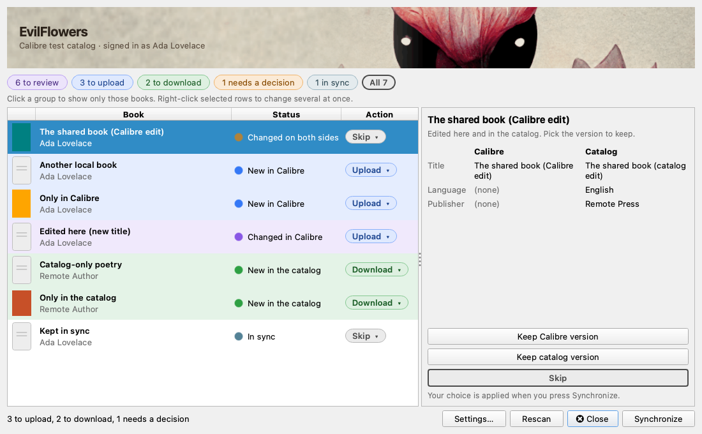 | 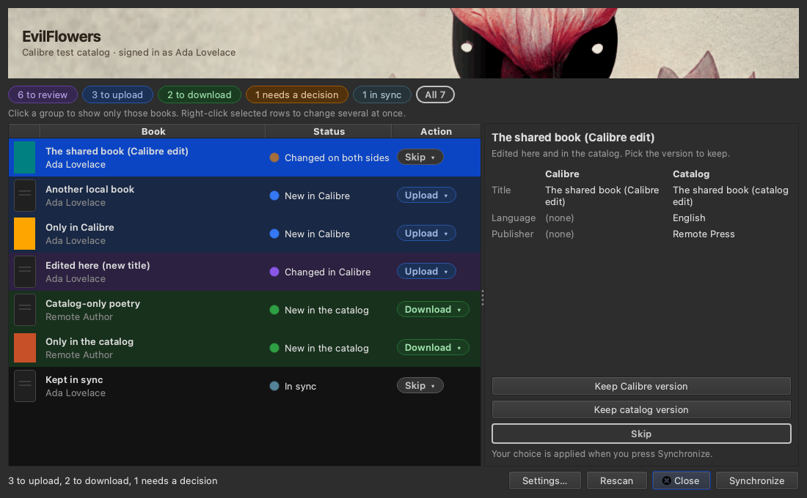 |

Before the plugin is set up, the window says so and offers the settings, instead of
showing an error.

| Light | Dark |
| --- | --- |
| 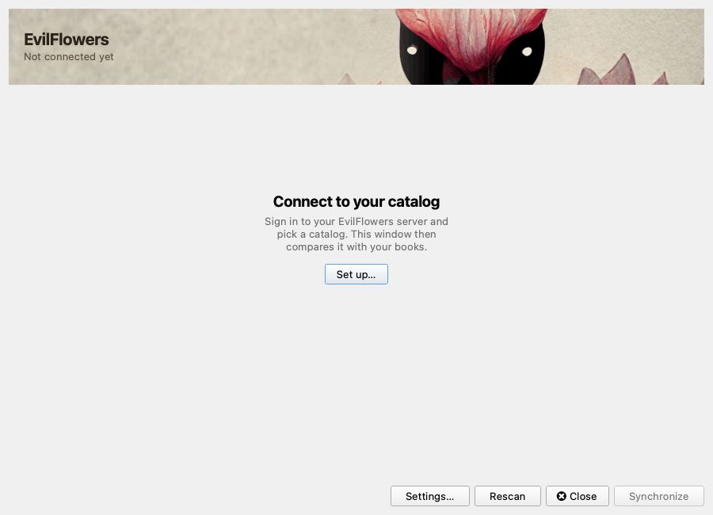 | 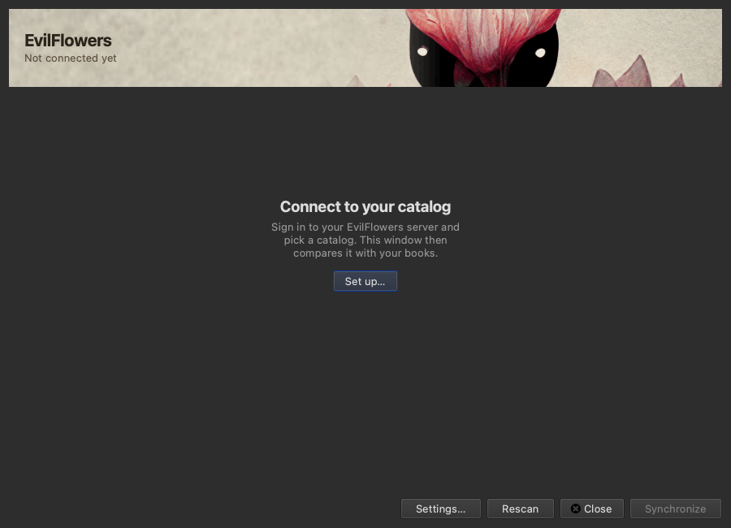 |

## Sign in

Your username and password are used once, to create an API key for this computer.
Only the key is saved.

| Light | Dark |
| --- | --- |
| 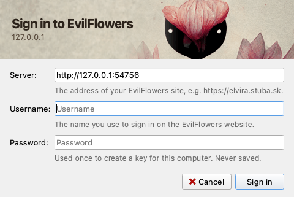 | 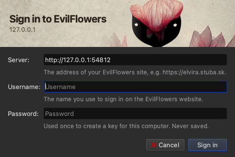 |

## Settings

Every field says what it is for. The catalog is picked from the ones your account can
see.

| Light | Dark |
| --- | --- |
| 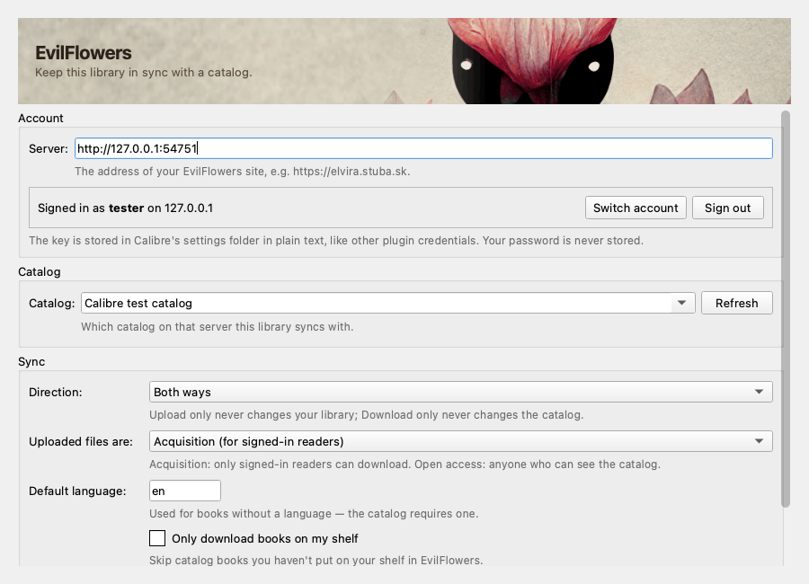 | 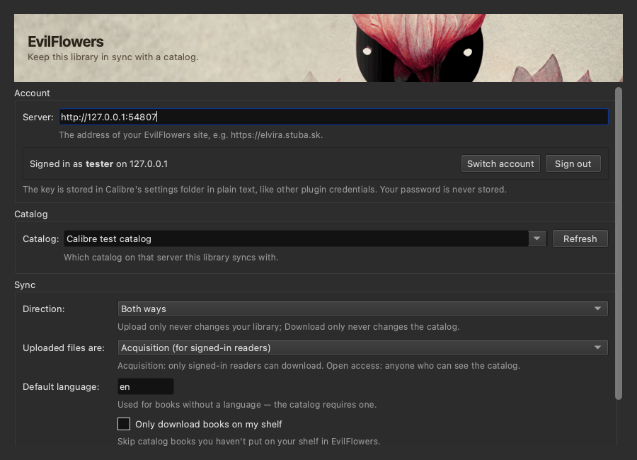 |

## Browse catalog

Search the catalog, filter by language or category, and download just the books you
pick. Badges show what is already in your library or on your EvilFlowers shelf.

| Light | Dark |
| --- | --- |
| 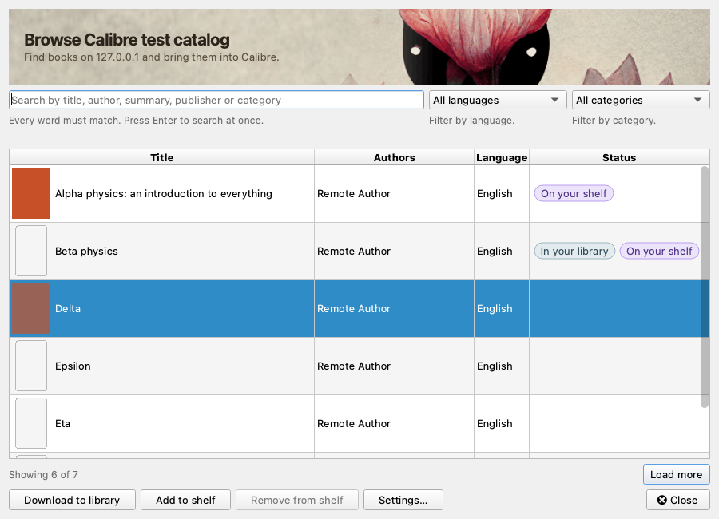 | 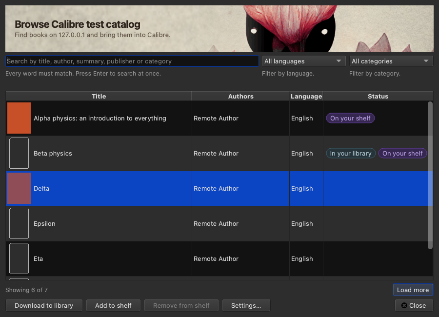 |

## Highlights

Passages you highlighted in the EvilFlowers reader, grouped and with page numbers.
Read-only: copy them, or save them into a long-text custom column.

| Light | Dark |
| --- | --- |
| 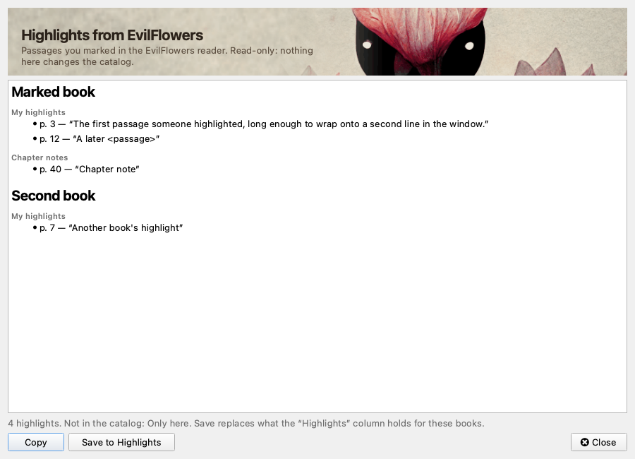 | 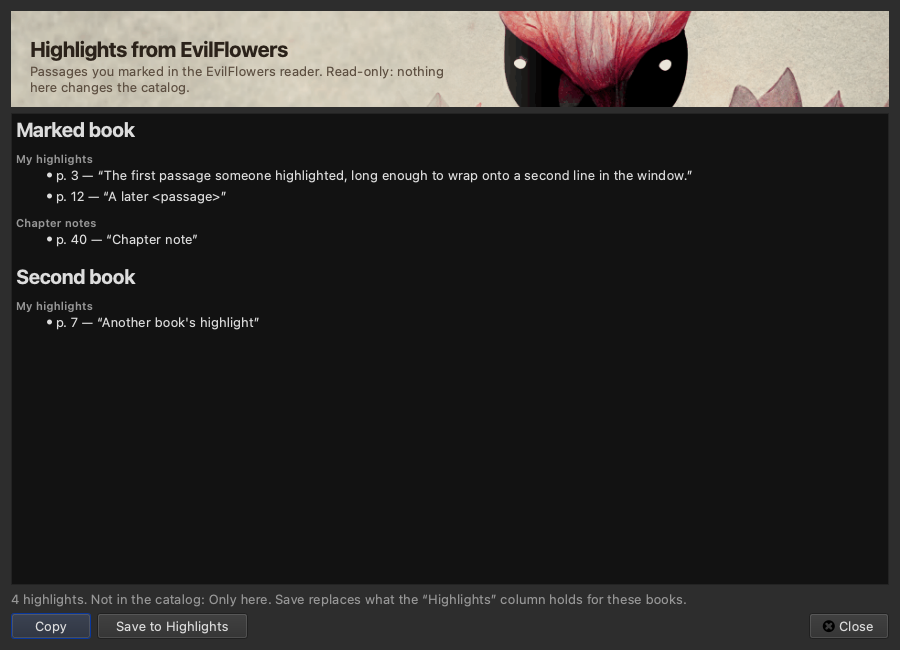 |
